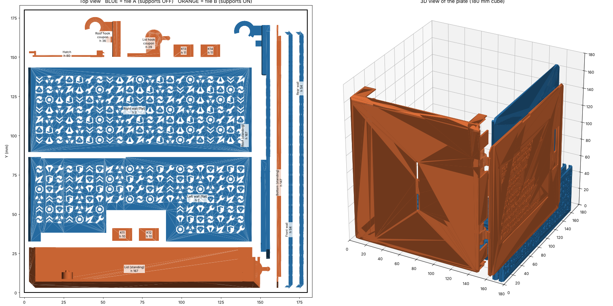

# All 14 parts on one Bambu Lab A1 Mini plate

All 14 parts fit on one 180 × 180 × 180 mm plate. They're split into two groups that fit
together on the bed like puzzle pieces:

| File | Supports | Parts |
|---|---|---|
| **A_SUPPORTS_OFF_pattern_parts** (blue) | **OFF** | Roof (02), Front wall (03), Rear wall (04), Left wall (05), Right wall (06) |
| **B_SUPPORTS_ON_other_parts** (orange) | **ON** | Lid (01), Green toast bottom, Hatch (15), Tab keepers 11–14, both hinge-hook test coupons |

Each file comes as `.stl` and `.3mf`. Every part is already in its final spot and orientation,
in A1 Mini bed coordinates (0–180 mm).

## Loading it in Bambu Studio

**Easiest:** open `BOTH_pre-placed_on_one_plate.3mf`. If Bambu Studio asks, choose to load
geometry only. You get two objects, `A_SUPPORTS_OFF…` and `B_SUPPORTS_ON…`, already fitted
together. Set supports per object: select it in the object list, then use the object settings
(right-click → Add settings, or the per-object Support settings).

**Or** import `A_…stl` and `B_…stl` separately. They should land in the right place. If the
slicer moves them, set each object's position. Bambu Studio's Position fields show the centre
of the object's bounding box:

| Object | X | Y |
|---|---|---|
| A_SUPPORTS_OFF_pattern_parts | 90.00 | 87.72 |
| B_SUPPORTS_ON_other_parts | 83.15 | 89.22 |

Compare the result with the picture above. **Do not press Arrange (A):** it would pull the
interlocked groups apart.

## Recommended settings

* **Object A:** supports **off**, with one exception (see "Roof hooks" below).
* **Object B:** supports **on**. Tree (auto) with *On build plate only* works well. None of B's
  supports need to land on another part.
* **Brim:** use *Outer brim only*, about 5 mm, on both objects. Several parts stand tall on a
  thin edge: roof 167 mm, lid 167 mm, bottom 147 mm, hatch 80 mm. An outer brim never goes
  into the cutouts of the flat walls.
* Use a clean plate with glue stick. If you see wobble on the tall panels, lower the outer-wall
  speed.

## Why the parts are oriented this way

Laid flat, the 14 parts cover about 115,000 mm². The bed is 32,400 mm². So the big panels
have to stand on edge, like toast in a rack:

| Part | Orientation on this plate | Why |
|---|---|---|
| Left wall, Right wall | **Flat** (cutouts vertical) | Perfect pattern, no bridging at all |
| Front wall, Rear wall | Standing on their long edge, 54 mm tall | 5 mm thick, so stable; icon tops are small (< 8 mm) bridges |
| Roof | Standing, 167 mm tall | The only standing direction where its display windows bridge ~45–55 mm instead of ~65–80 mm |
| Lid | Standing, 167 mm tall | Its rim gives it the largest base of any standing option (3,000 mm²) |
| Green toast bottom | Standing, 147 mm tall | Text plaque prints cleanly on a vertical face |
| Hinge test coupons | **Same orientation as their parent part** | So each coupon still tests the hook the way it will really print |
| Keepers, hatch | Tucked into the gaps (two keepers sit in the left wall's notch) | |

The source files placed **05_Left_wall** and **Green_toast_bottom** tilted, touching the bed on
a single edge. Here they're squared up properly.

## Things to know (honest trade-offs)

1. **Roof hooks need a little support.** With the roof standing, its two hinge-hook pairs (back
   right corner, at about 20–50 mm and 110–140 mm height) stick out sideways. To keep the
   pattern support-free and still save the hooks: on object A, turn supports on with type
   **Tree (manual)** and paint only the hook undersides with the support-painting tool. Manual
   mode only puts supports where you paint, so the pattern stays untouched. Skip this and the
   hooks will likely droop.
2. **Bridges on standing parts:** the front wall's window top edge is about a 70 mm bridge and
   the roof windows are about 45–55 mm. Each icon cutout on a standing part bridges its top
   edge, but those spans are tiny. Expect a little sag on the long window edges only.
3. **Tall thin panels** (roof, bottom, hatch) are the main risk on a one-plate print. Use the
   brim and watch the first layers.
4. **Test coupons:** on the same plate they can't warn you before the real parts print. If you
   want them as true pre-tests, delete everything else and print them first (about 20 minutes).
5. **The lid file had 6 small non-manifold edges** in the original STL. Bambu Studio repairs
   these automatically on load.

Total plastic volume is 248 cm³, about 300 g of PLA at most. Real weight depends on infill and
walls.
